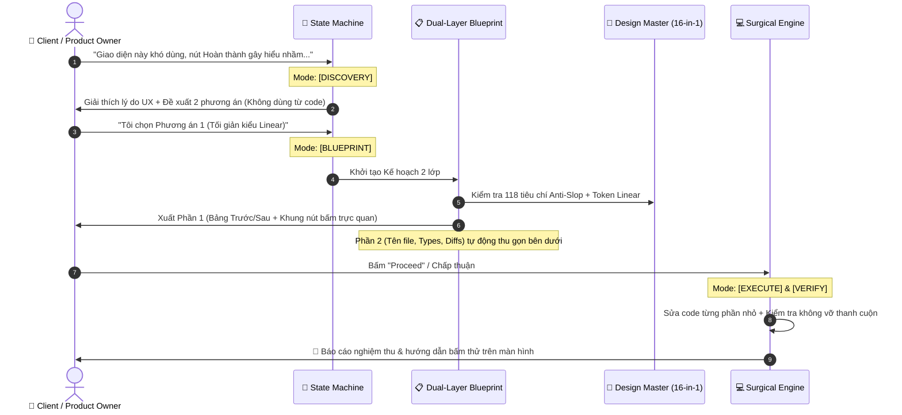

<div align="center">

# ⚡ Strict Architect & UI/UX Design Master Suite

**The Dual-Engine Agent Skill Toolkit for Antigravity, Claude Code, Cursor & GitHub Copilot.**  
*Bridging the gap between human client expectations and surgical AI engineering.*

[](https://github.com/Skill-AI-private/Strict-architect-coder)
[](https://github.com/Skill-AI-private/Strict-architect-coder)
[](https://github.com/Skill-AI-private/Strict-architect-coder)
[](LICENSE)

<br/>

```text
┌────────────────────────────────────────────────────────────────────────────────────────┐
│                                                                                        │
│   🧑 Human User (Client / Product Owner)                                               │
│         │                                                                              │
│         ▼                                                                              │
│   🧠 strict-architect-coder (v3.0) ────► 1. Client-First Plan (Zero Jargon + Wireframe)│
│                                    ────► 2. Collapsed AI Spec (Types, Blast-Radius)    │
│         │                                                                              │
│         ▼                                                                              │
│   🎨 ui-ux-design-master (16-in-1) ────► 12 GitHub Design Repos + 4 Stability Pillars  │
│                                    ────► 118 Anti-Slop Rules + 5-State Matrix          │
│         │                                                                              │
│         ▼                                                                              │
│   🚀 Production-Grade Code (Surgical Diffs, Zero Drift, Zero Hanging Terminal Tasks)   │
│                                                                                        │
└────────────────────────────────────────────────────────────────────────────────────────┘
```

</div>

---

## 💡 Why This Exists: The Problem with Raw AI Coding

Default AI coding assistants (even flagship frontier models) consistently suffer from four critical production failure modes:

| Problem | Standard AI Behavior | With This Skill Suite |
| :--- | :--- | :--- |
| **Premature Coding** | Jumps straight to editing files after vague prompts, guessing interfaces and hallucinating functions. | **State Machine Enforced:** Traps AI in `[MODE: DISCOVERY]` or `[MODE: BLUEPRINT]` until requirements and scope boundaries are locked. |
| **Communication Gap** | Dumps raw code jargon (`props`, `useState`, `endpoints`) on non-technical users during `/plan` or `/grill-me`. | **Dual-Layer Protocol:** Top layer is 100% plain client language (Before/After tables + ASCII wireframes); Technical spec is cleanly collapsed. |
| **AI Slop & Broken UI** | Generic purple-to-blue gradients, cookie-cutter 3-column cards, unreadable low-contrast text, broken scrollbars. | **118-Point Quality Gate:** Enforces real design tokens (`DESIGN.md`), UX psychology, Vercel UI standards, and physics-based motion. |
| **Terminal & Scope Drift** | Launches heavy background CLI benchmarks or backend tests when asked to fix a simple frontend button. | **Domain Isolation & Anti-Hang:** Locks UI requests strictly to frontend files; terminates blocking background processes automatically. |

---

## 📦 What's Inside: The 2-in-1 Architecture

This repository packages two interoperable, production-hardened skills designed to be loaded progressively without polluting context tokens:

### 1. 🧠 `strict-architect-coder` (v3.0 Dual-Layer Protocol)
* **Client-First Interviewing (`/grill-me`):** AI assumes the role of a Product Consultant. It silently decides internal technical details and only asks high-value user-experience questions with clear Pros/Cons.
* **Dual-Layer Blueprint (`/plan`):**
  * *Part 1 (Client View):* Human-readable goals, Before/After experience table, visual ASCII layout wireframes, and step-by-step user journey.
  * *Part 2 (AI Technical Spec — Collapsed):* Strict file modification whitelist, protected untouched boundaries, contract/type checks, and atomic micro-tasks.
* **Surgical Execution:** Minimal diff principle, zero code guessing (read-before-write), and zero hanging background terminal tasks.

### 2. 🎨 `ui-ux-design-master` (12 Top GitHub Repos + 4 Stability Pillars)
A unified synthesis of the 12 most influential frontend and design engineering repositories on GitHub, reinforced with 4 real-world usability foundations:

```text
ui-ux-design-master/
├── 🏛️ 4 Stability Pillars (Usability First)
│   ├── UX Psychology (Hick's, Fitts's, Jakob's Laws: No blind buttons, contextual labels)
│   ├── Vercel Web Interface Guidelines (Full keyboard ergonomics, focus rings, zero layout shift)
│   ├── Anti-Overflow Layout Safety (min-h-0 / min-w-0 flex guards, independent scroll panes)
│   └── AI & Multi-Agent UI Patterns (Live progress timers, mandatory [Stop/Cancel] escape hatch)
│
├── 🎨 The 12 Synthesized GitHub Design Engines
│   ├── nexu-io/open-design         ──► Multi-variant local prototyping & side-by-side canvas
│   ├── Leonxlnx/taste-skill        ──► Intentional art direction, visual hierarchy & browser checks
│   ├── ui-ux-pro-max-skill         ──► Domain-specific color palettes, typography scales & chart matrix
│   ├── google-labs-code/design.md  ──► Open standard for persistent machine/human design systems
│   ├── VoltAgent/awesome-design-md ──► Battle-tested design tokens (Linear, Stripe, Apple, Vercel, Notion)
│   ├── pbakaus/impeccable          ──► 24 workflow commands & 61 deterministic anti-slop rules
│   ├── nutlope/hallmark            ──► 57 design quality criteria & structural macrostructures
│   ├── emilkowalski/skills         ──► Sub-250ms physics motion, natural cubic-bezier curves, micro-polish
│   ├── DavidHDev/react-bits        ──► 200+ tactile React animated components & interactive backgrounds
│   ├── greensock/gsap-skills       ──► Production-safe GSAP timelines, useGSAP() cleanup & ScrollTrigger
│   ├── 🔒 DavidHDev/canvas-ui      ──► Interactive HTML-in-Canvas WebGL shaders (Safety-Locked)
│   └── 🔒 oso95/scroll-world       ──► 3D camera fly-through landing pages (Safety-Locked)
```

> **🛡️ Safety Lock Notice:** Creative 3D (`Scroll World`) and WebGL shaders (`Canvas UI`) are locked by default to prevent high GPU drain and accessibility issues on productivity apps. They only activate upon explicit user request.

---

## ⚡ Quick Installation

Install once, use everywhere. The universal installer automatically maps both skills into the global directories of **Google Antigravity**, **Claude Code**, and **GitHub Copilot**.

### 🪟 Windows (PowerShell)

```powershell
# Clone the repository
git clone https://github.com/Skill-AI-private/Strict-architect-coder.git "$HOME\.gemini\config\skills\strict-architect-coder"

# Run the universal installer (installs both skills to all supported AI harnesses)
& "$HOME\.gemini\config\skills\strict-architect-coder\scripts\install.ps1" -Target all
```

*To update anytime:*
```powershell
git -C "$HOME\.gemini\config\skills\strict-architect-coder" pull
& "$HOME\.gemini\config\skills\strict-architect-coder\scripts\install.ps1" -Target all
```

---

### 🍎 macOS & 🐧 Linux (Bash)

```bash
# Clone the repository
git clone https://github.com/Skill-AI-private/Strict-architect-coder.git ~/.gemini/config/skills/strict-architect-coder

# Run the universal installer
bash ~/.gemini/config/skills/strict-architect-coder/scripts/install.sh all
```

---

### 📂 Project-Specific / Workspace Install
If you want to bundle these skills inside a specific Git repository (`.agents/skills`, `.claude/skills`, `.github/skills`) to share with your team:

```powershell
# Windows
.\scripts\install.ps1 -Target workspace -WorkspacePath "C:\path\to\your\project"

# macOS / Linux
bash ./scripts/install.sh workspace /path/to/your/project
```

---

## 📂 Repository Layout

```text
Strict-architect-coder/
├── SKILL.md                                  # Skill 1 Core: strict-architect-coder (Dual-Layer)
├── README.md                                 # Production documentation
├── references/                               # Skill 1 Progressive Disclosure Playbooks
│   ├── client-communication-and-plan-template.md  # Jargon translation & ASCII wireframe specs
│   ├── planning-and-architecture.md               # 3-layer dependency mapping & atomic task decomposition
│   ├── ui-ux-and-frontend.md                      # Usability audit & 5-state UI matrix
│   └── systematic-debugging.md                    # 4-step scientific root-cause debugging loop
│
├── ui-ux-design-master/                      # Skill 2 Core: 16-in-1 Design & Stability Suite
│   ├── SKILL.md                              # 5-Pillar Router & 16-Engine Coordinator
│   └── references/
│       ├── 01-ux-psychology-vercel-and-layout-safety.md # Usability, Vercel guidelines & CSS flex safety
│       ├── 02-open-design-and-taste-prototyping.md      # Multi-variant prototyping & aesthetic direction
│       ├── 03-design-md-and-brand-archetypes.md         # Google DESIGN.md spec & curated design tokens
│       ├── 04-impeccable-hallmark-anti-slop-gate.md     # 118-Point visual & structural audit checklist
│       └── 05-motion-gsap-and-locked-3d-canvas.md       # Physics motion, GSAP & locked 3D/WebGL recipes
│
└── scripts/                                  # Multi-Platform Automated Installers
    ├── install.ps1                           # Windows PowerShell engine
    └── install.sh                            # Unix / macOS POSIX Bash engine
```

---

## 🎯 How It Operates in Daily Workflow



---

## 🤝 Acknowledgments & Heritage

This suite stands on the shoulders of the open-source pioneers who transformed agentic coding and web design:

- **Planning & Discipline:** `obra/superpowers` & `addyosmani/agent-skills`
- **UI/UX Anti-Slop:** `pbakaus/impeccable` & `nutlope/hallmark`
- **Design Intelligence & Taste:** `Leonxlnx/taste-skill` & `nextlevelbuilder/ui-ux-pro-max-skill`
- **Design Token Standards:** `google-labs-code/design.md` & `VoltAgent/awesome-design-md`
- **Physics Motion & Creative Engineering:** `emilkowalski`, `greensock`, `DavidHDev`, and `oso95`

---

<div align="center">

Crafted with precision for next-generation Agentic Software Engineering.  
*Star this repository if it saved your AI from shipping slop.*

</div>
